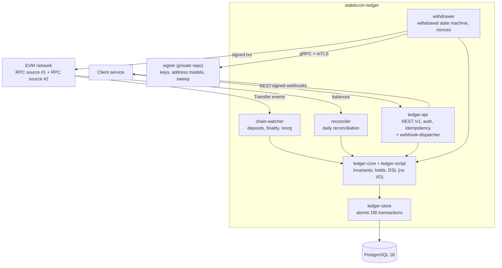
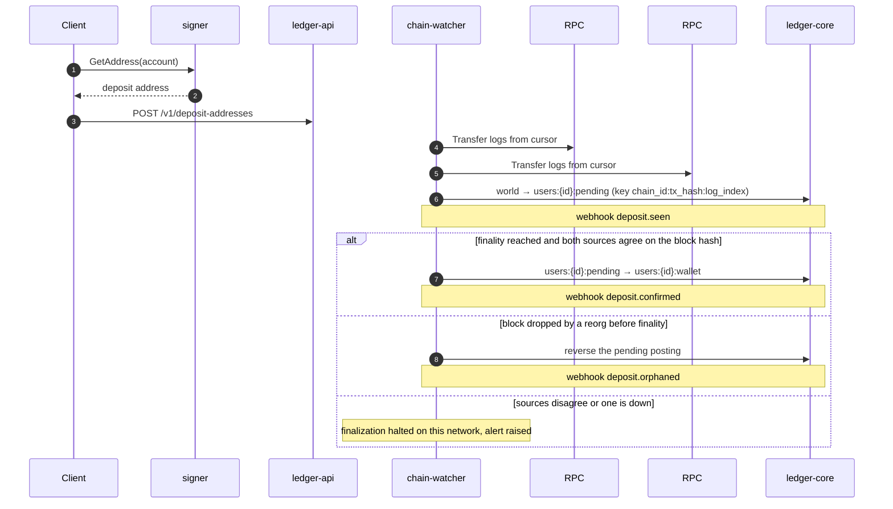
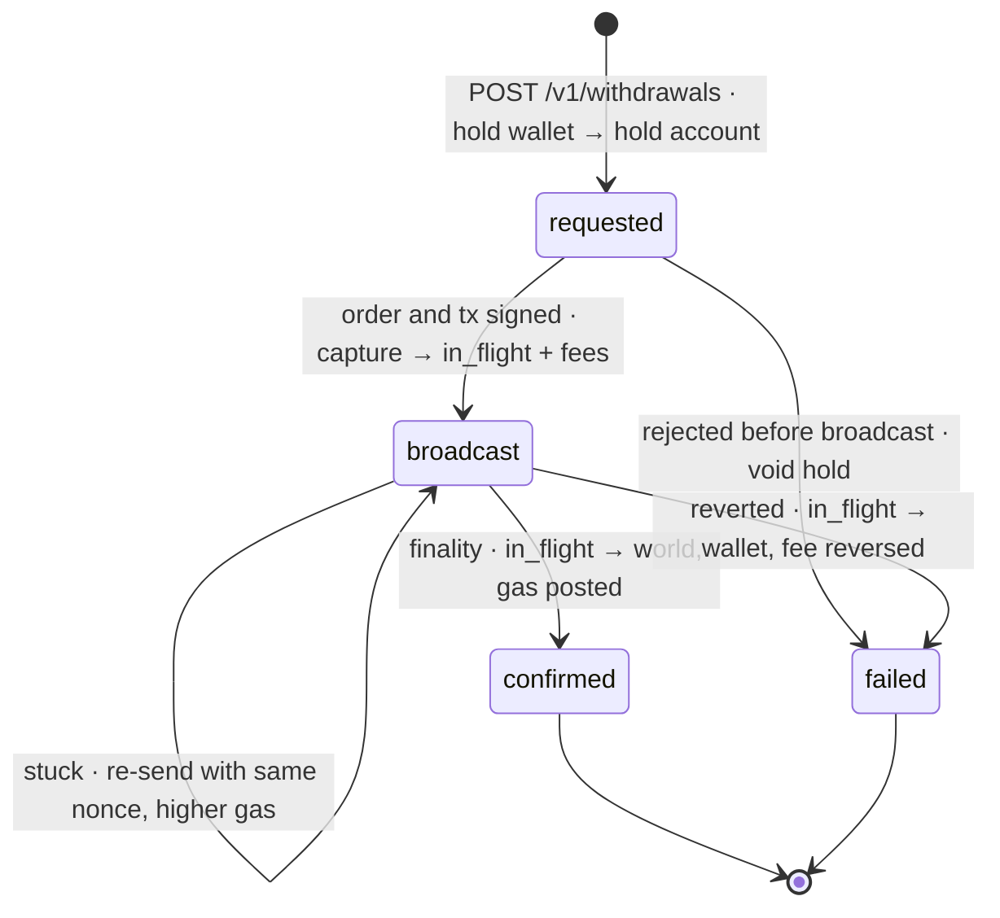
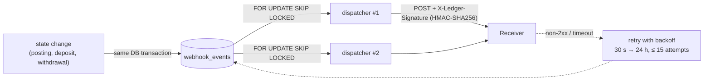
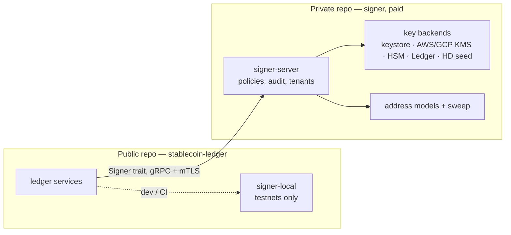

# Stablecoin Ledger — Architecture

Every movement of money is a posting in a double-entry journal, and only `ledger-core` can write one: no service touches the journal tables directly. This document explains how the parts fit together; the normative requirements (FR/NFR/SIG ids) live in [specification.md](specification.md).

## Components



| Crate | Responsibility |
|---|---|
| `ledger-core` | Accounts, assets, postings, holds, invariants. No I/O, so it is fully testable without a database |
| `ledger-script` | Transaction DSL: parser and compiler to postings. Depends only on `ledger-core` |
| `ledger-store` | PostgreSQL implementation of the storage trait: journal, materialized balances, migrations |
| `ledger-api` | REST `/v1` (axum), API-key auth with roles, idempotency, OpenAPI 3.1; hosts the `webhook-dispatcher` worker (separate command) |
| `chain-watcher` | Indexes `Transfer` events to registered addresses from two RPC sources; tracks finality and reorgs; recognizes sweeps |
| `withdrawer` | Withdrawal state machine, nonce management, re-send of stuck transactions; talks to the signer |
| `reconciler` | Daily comparison of the journal with on-chain balances |
| `signer-proto` | gRPC contract and the `Signer` trait |
| `signer-local` | Local signer for anvil and Sepolia; refuses to start with a mainnet network |

Each service is a separate binary over the same core, so they scale and fail independently. They share the database, never each other's process.

## The money model

- A **posting** moves an amount of one asset from a source account to a destination account; a **transaction** is an atomic set of 1–256 postings.
- **Invariant:** for every asset the sum of all balances, `world` included, is zero. Only `world` and system accounts may go negative.
- Amounts are `u128` base units with checked arithmetic; floats are forbidden.
- The journal (`transactions`, `postings`) is append-only, enforced by a DB trigger. Corrections are reversals. `balances` is a materialized view updated in the same DB transaction and can be rebuilt from the journal at any time.
- Accounts in a transaction are locked in address order, so concurrent debits never deadlock and never overdraw.

Account layout used by the flows below:

| Account | Holds |
|---|---|
| `world` | The outside world: source of deposits, destination of withdrawals |
| `users:{id}:pending` | Deposits seen on-chain, not yet final |
| `users:{id}:wallet` | Spendable user balance |
| `holds:{id}` | Funds reserved for a withdrawal or other hold |
| `chain:{net}:in_flight` | Withdrawals broadcast but not yet final |
| `platform:fees` · `platform:gas:{net}` | Platform fees · gas spent |

## Deposit flow

The ledger never generates deposit addresses: the address model depends on the key storage type and lives in the signer (or the client's own system). The ledger only registers the mapping.



The cursor (block number + hash) is persisted, and every event is keyed by `chain_id:tx_hash:log_index`, so a restart at any point never double-credits or skips a deposit.

**Sweep** is executed by the signer. The watcher recognizes a `Transfer` from a deposit address to a registered hot wallet as a sweep: user balances stay unchanged, and only the actual gas from the receipt is posted (`platform:gas:{net} → world`).

## Withdrawal flow



- Every transition and its posting are written in **one DB transaction**.
- The nonce and the signed transaction are persisted **before** broadcast; after a crash the withdrawer only re-sends the same transaction, so a payout can never happen twice.
- The ledger signs a withdrawal order (ed25519) when the hold is created; the signer refuses any transaction that does not match a valid order.
- Without a connected signer the withdrawer does not start and the endpoint returns `501 SIGNER_NOT_CONFIGURED`.

## Webhooks



The transactional outbox guarantees an event exists if and only if its change was committed. Delivery is at-least-once; receivers deduplicate by `X-Ledger-Event-Id` and order within a resource by `sequence`.

## Reconciliation

Once a day (default 00:00 UTC) the reconciler checks, per asset:

```text
Σ on-chain balance (finalized block) = −balance(world) − Σ balance(users:*:pending)
```

On-chain balances are read from both RPC sources. The result is stored; a non-zero difference raises an alert, emits `reconciliation.mismatch` and, if configured, halts withdrawals of that asset.

## Trust boundaries and open core



- Private keys never enter this repository; the ledger knows only the gRPC contract.
- Without a subscription the ledger is read-only towards the chain: journal, deposits, reconciliation and webhooks work; withdrawals are disabled.
- `signer-local` implements the same contract, so the public repository builds and passes e2e tests on its own.

## Technology stack

| Layer | Choice |
|---|---|
| Language / runtime | Rust stable (edition 2024), `tokio` |
| HTTP | `axum`, `tower`, `utoipa` (OpenAPI 3.1) |
| Storage | PostgreSQL 18, `sqlx` with compile-time checked queries |
| Blockchain | `alloy` (EVM); anvil locally, Ethereum Sepolia as the first real network |
| Observability | `tracing` (JSON logs), OpenTelemetry, Prometheus metrics |
| Tests | `proptest`, `testcontainers`, `criterion`, anvil, `wiremock`, `cargo-fuzz` |
