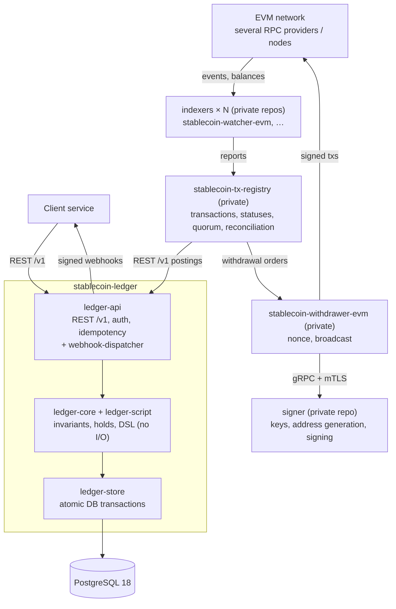
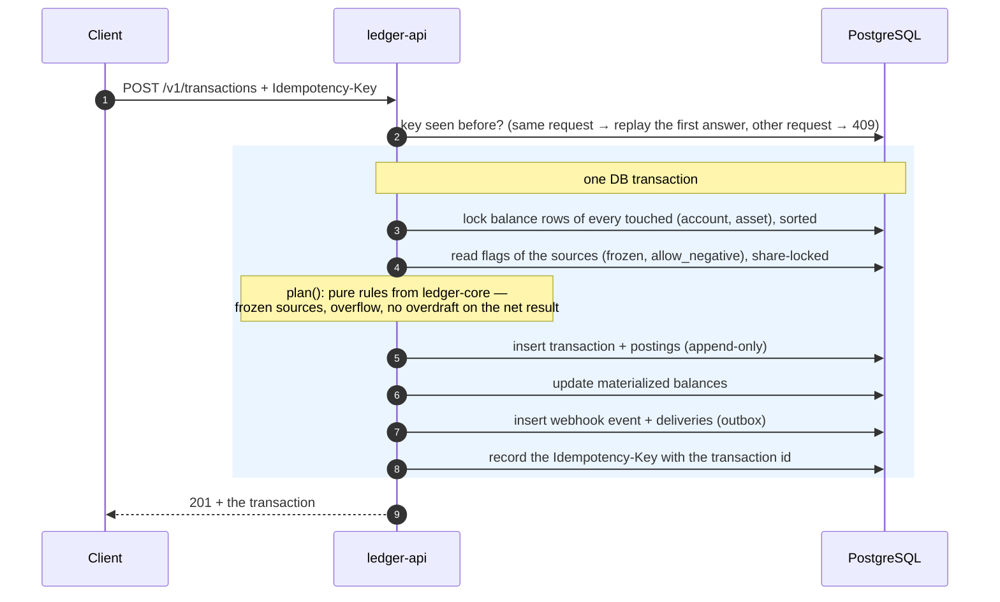
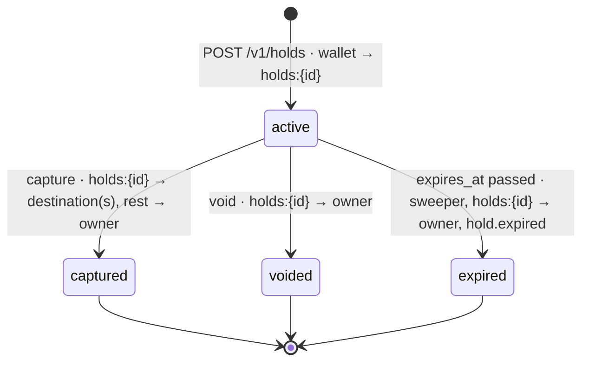
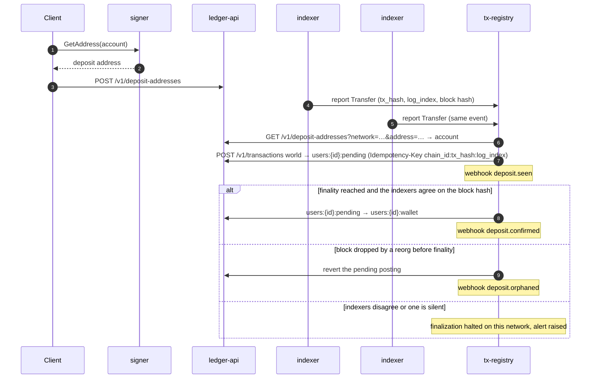
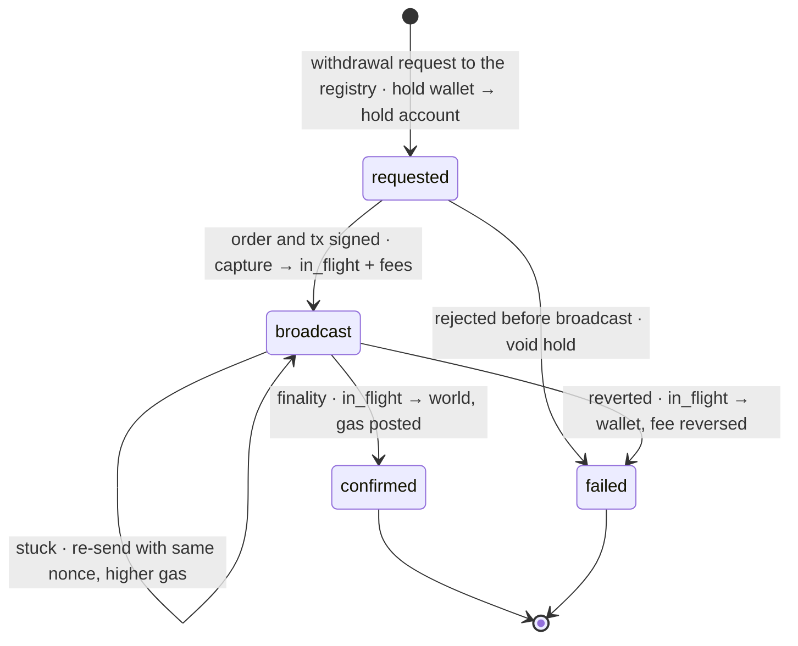
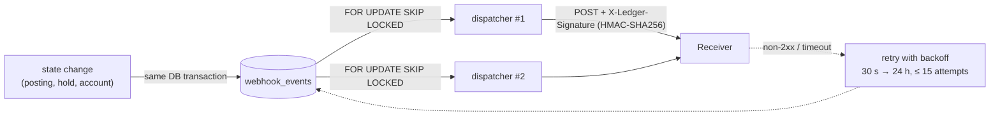
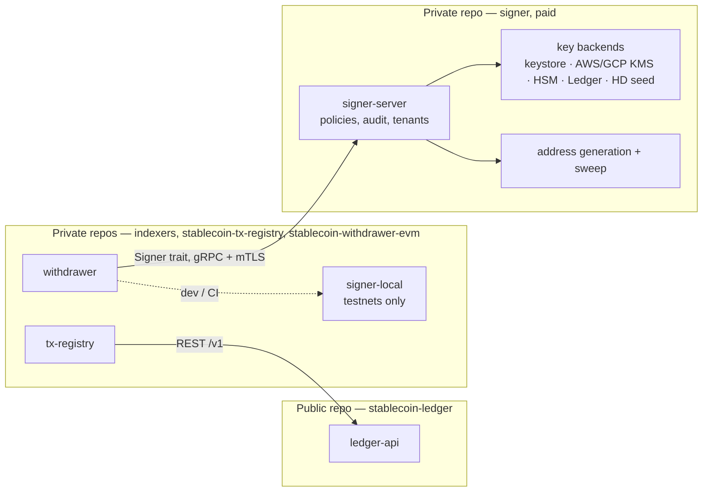

# Stablecoin Ledger — Architecture

Every movement of money is a posting in a double-entry journal, and only `ledger-core` can write one: no service touches the journal tables directly. The ledger only keeps accounts and is independent of any chain; everything on-chain lives in private repositories with their own databases — the indexers, the transaction registry (`stablecoin-tx-registry`), the withdrawer (`stablecoin-withdrawer-evm`) and the signer — and reaches the ledger only through its REST API. `stablecoin-dev` runs the whole system locally. This document explains how the parts fit together; the normative requirements (FR/NFR/SIG ids) live in [specification.md](specification.md).

## Components



| Crate | Responsibility |
|---|---|
| `ledger-core` | Accounts, assets, postings, holds, invariants. No I/O, so it is fully testable without a database |
| `ledger-script` | Transaction DSL: parser and compiler to postings. Depends only on `ledger-core` |
| `ledger-store` | PostgreSQL implementation of the storage trait: journal, materialized balances, migrations |
| `ledger-api` | REST `/v1` (axum), API-key auth with roles, idempotency, OpenAPI 3.1; hosts the `webhook-dispatcher` worker (separate command) |

Each chain-side service has its own repository and database. None of them reads or writes the ledger database; the transaction registry is the only one that writes to the ledger, through the API. Every network is watched by several independent indexers, and the registry acts on an event only when the quorum agrees (FR-27).

## The money model

- A **posting** moves an amount of one asset from a source account to a destination account; a **transaction** is an atomic set of 1–256 postings.
- **Invariant:** for every asset the sum of all balances, `world` included, is zero. Only `world` and system accounts may go negative.
- Amounts are `u128` base units with checked arithmetic; floats are forbidden.
- The journal (`transactions`, `postings`) is append-only, enforced by a DB trigger. Corrections are reversals. `balances` is a materialized view updated in the same DB transaction and can be rebuilt from the journal at any time.
- Accounts in a transaction are locked in address order, so concurrent debits never deadlock and never overdraw.

Account layout used by the flows below:

| Account | Holds |
|---|---|
| `world` | The outside world: source of deposits, destination of withdrawals |
| `users:{id}:pending` | Deposits seen on-chain, not yet final |
| `users:{id}:wallet` | Spendable user balance |
| `holds:{id}` | Funds reserved for a withdrawal or other hold |
| `chain:{net}:in_flight` | Withdrawals broadcast but not yet final |
| `platform:fees` · `platform:gas:{net}` | Platform fees · gas spent |

## Writing a transaction

Every write — a transfer, a hold, a script run, a reversal — follows the same path, and everything in the box commits or rolls back together:



- The rules live once, in `ledger_core::plan`, and the in-memory journal and PostgreSQL both call it, so the property tests of the core cover the database path too.
- Rows are locked in `(account, asset)` order, so two transfers touching the same accounts queue instead of deadlocking, and a balance is never read stale.
- A request that races another with the same key fails on the key's unique index, rolls back, and is answered from the winner's record: one write, two identical answers.

## Hold lifecycle



Each transition is one ledger transaction, so the funds of a hold are always in exactly one place: the owner's wallet, `holds:{id}`, or the destinations. A capture may split between several destinations (a withdrawal's amount and fee). Past its deadline a hold can no longer be captured, only voided, until the sweeper (`FOR UPDATE SKIP LOCKED`, safe on any number of replicas) expires it.

## Deposit flow

The ledger never generates deposit addresses: the address model depends on the key storage type and lives in the signer (or the client's own system). The ledger only registers the mapping, and the transaction registry reads it.



Each indexer persists its cursor (block number + hash), the registry stores every report, and every posting is keyed by `chain_id:tx_hash:log_index` (with `:{attempt}` after a reorg re-inclusion), so a restart at any point never double-credits or skips a deposit.

**Sweep** is executed by the signer. The indexers report a `Transfer` from a deposit address to a registered hot wallet as a sweep: user balances stay unchanged, and the registry posts only the actual gas from the receipt (`platform:gas:{net} → world`).

## Withdrawal flow

The transaction registry keeps the withdrawal state machine and writes each transition as one ledger request; the withdrawer signs (through the signer) and broadcasts; the indexers report the on-chain result, which the registry matches by `(hot wallet, nonce)`, since a re-sent transaction has a new hash.



- Every transition's posting is one atomic ledger transaction, guarded by an idempotency key.
- The nonce and the signed transaction are persisted **before** broadcast; after a crash the withdrawer only re-sends the same transaction, so a payout can never happen twice.
- The registry signs a withdrawal order (ed25519) when the hold is created; the signer refuses any transaction that does not match a valid order.
- Without a connected signer withdrawals are not processed and the registry's endpoint returns `501 SIGNER_NOT_CONFIGURED`.
- An outgoing hot-wallet transfer that matches no withdrawal raises an alert.

## Webhooks



The transactional outbox guarantees an event exists if and only if its change was committed. Delivery is at-least-once; receivers deduplicate by `X-Ledger-Event-Id` and order within a resource by `sequence`.

## Reconciliation

Once a day (default 00:00 UTC) the transaction registry checks, per asset, with balances read from the ledger API:

```text
Σ on-chain balance (finalized block) = −balance(world) − Σ balance(users:*:pending)
```

On-chain balances come from the indexers' quorum. The result is stored; a non-zero difference raises an alert, emits the registry's `reconciliation.mismatch` webhook and, if configured, halts withdrawals of that asset.

## Trust boundaries and open core



- Private keys never enter this repository; the ledger does not talk to the signer at all.
- Without a signer subscription the chain side is read-only towards the chain: deposits and reconciliation work, withdrawals are disabled; the ledger itself is unaffected.
- `signer-local` implements the same contract, so the withdrawer builds and passes e2e tests without the `signer` repository.

## Technology stack

| Layer | Choice |
|---|---|
| Language / runtime | Rust stable (edition 2024), `tokio` |
| HTTP | `axum`, `tower`, `utoipa` (OpenAPI 3.1) |
| Storage | PostgreSQL 18, `sqlx` with compile-time checked queries |
| Blockchain | none in the ledger; the indexers and the withdrawer use `alloy` (EVM), anvil locally and Ethereum Sepolia |
| Observability | `tracing` (JSON logs), OpenTelemetry, Prometheus metrics |
| Tests | `proptest`, `testcontainers`, `criterion`, anvil, `wiremock`, `cargo-fuzz` |
