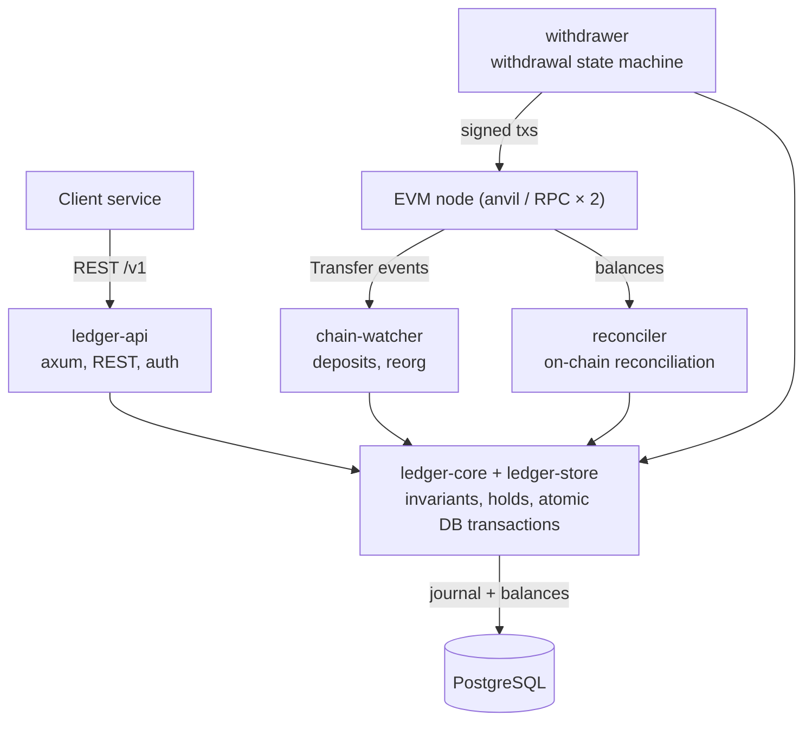

# Stablecoin Ledger — Specification

Status: accepted for MVP · Last updated: 2026-11-15

## 1. Overview

Stablecoin Ledger is a source-available (BSL 1.1) double-entry ledger engine written in Rust for custodial services that hold stablecoins (USDC, USDT, DAI) on behalf of their users. Internal transfers settle instantly in an off-chain journal; the system touches the blockchain only for deposits and withdrawals.

**Project goal:** demonstrate the design of a financially correct, concurrency-safe system integrated with a blockchain. The conceptual reference is Formance Ledger.

**Target scenarios:**

- crypto wallet or exchange: user balances, deposits, withdrawals;
- payment service: transfers between customers and merchants with a platform fee;
- corporate treasury: accounting for hot and cold wallets across several networks.

**Distribution model (open core):**

| Mode | What works |
|---|---|
| Public ledger, no subscription | Journal and internal transfers, deposit indexing, balances, reconciliation, webhooks. Read-only access to the blockchain: withdrawals are disabled |
| Ledger + paid signing service | Everything above + on-chain withdrawals, issuing deposit addresses and sweeping them with the model that matches the key type, multiple key types (section 7.1) |
| Development and CI | `signer-local` signs only on local and test networks (anvil, Sepolia) |

**License:** Business Source License 1.1, converting to Apache-2.0 four years after each release (terms in section 12).

## 2. Glossary

| Term | Meaning |
|---|---|
| Account | Hierarchical address for tracking funds, e.g. `users:42:wallet` |
| Asset | A token on a specific network with its precision: `USDC@ethereum/6` |
| Posting | Movement of an amount of one asset from a source account to a destination account |
| Transaction | An atomic set of postings; applied in full or not at all |
| Hold | A reservation of funds, later confirmed (capture) or cancelled (void) |
| `world` | System account representing the outside world; the only account allowed a negative balance |
| Finality | Number of confirmations after which a blockchain transaction is considered irreversible |
| Reorg | A chain reorganization after which a transaction may disappear |
| Reconciliation | Comparing balances in the journal with the actual on-chain wallet balances |
| Idempotency key | A unique request key; a retry with the same key returns the first result |

## 3. Scope

The MVP covers Ethereum: a local anvil node with a mock ERC-20 token for tests, and Ethereum Sepolia with our own mock USDC as the first real network. Other networks come after the MVP.

**In the MVP:**

- double-entry core: accounts, assets, transactions, holds, balances;
- transaction DSL (section 5.7);
- PostgreSQL storage with atomic transactions;
- REST API with idempotency;
- webhooks for journal, deposit and withdrawal events, with guaranteed delivery and signatures;
- deposits to registered addresses: indexing `Transfer` events from two independent RPC sources, two-phase crediting, reorg handling;
- withdrawals through a hold, broadcasting the transaction from the hot wallet;
- reconciliation of the journal against on-chain balances;
- metrics, logging, Docker Compose for local runs.

**After the MVP:**

- Ethereum mainnet and additional networks (Base, Arbitrum, Tron, Solana);
- freezing accounts based on issuer blocklists.

**Out of scope for this repository:**

- production key storage (KMS, HSM, MPC): implemented in the private `signer` repository (section 7.1); this repository contains only the contract and a local signer for development;
- deposit address generation and sweeping: the address model (CREATE2 forwarders, HD derivation, etc.) depends on the key storage type, so it lives in `signer` (section 7.1); the ledger only registers addresses (FR-20);
- KYC/AML and regulatory reporting;
- end-user UI and end-user authentication;
- asset swaps and cross-chain bridges.

## 4. Data model

All monetary amounts are stored as integers in the token's base units (`u128`); floating-point types are forbidden throughout the codebase.

### 4.1 Accounts

- An address consists of `[a-z0-9_]+` segments separated by `:`, up to 256 characters.
- An account is created implicitly on its first posting (as in Formance).
- Metadata: arbitrary string–string pairs.
- Flags: `allow_negative` (only for `world` and system accounts), `frozen`.

Reserved namespaces:

| Account | Purpose |
|---|---|
| `world` | Source and destination of funds from outside |
| `users:{id}:wallet` | User's available balance |
| `users:{id}:pending` | Deposits awaiting finality |
| `chain:{network}:hot` | Mirror of the hot wallet on a network |
| `chain:{network}:in_flight` | Withdrawals broadcast but not yet confirmed |
| `platform:fees` | Platform fees |
| `platform:gas:{network}` | Gas spent, in the network's native asset |

### 4.2 Assets

- Format: `SYMBOL@network/decimals`, e.g. `USDC@ethereum/6`, `DAI@ethereum/18`, `ETH@ethereum/18`.
- The asset registry stores the contract address, chain id and finality threshold.
- The same coin on different networks is a different asset; postings between them are forbidden.

### 4.3 Transactions and postings

```rust
pub struct Posting {
    pub source: AccountAddress,
    pub destination: AccountAddress,
    pub amount: u128, // base units, > 0
    pub asset: AssetId,
}

pub struct Transaction {
    pub id: TxId,               // monotonic u64
    pub postings: Vec<Posting>, // 1..=256
    pub metadata: Metadata,
    pub reverts: Option<TxId>,
    pub timestamp: DateTime<Utc>,
}
```

Rules:

1. A posting amount is strictly greater than zero; `source` and `destination` differ.
2. A transaction is rejected if any account without `allow_negative` would go negative, or is frozen.
3. Transactions are immutable; corrections are made only by reversal (`reverts`), and a transaction can be reversed once.
4. Invariant: for every asset, the sum of all account balances (including `world`) is zero.

### 4.4 Holds

- `hold(account, amount, asset, expires_at?)` moves funds to the technical account `holds:{hold_id}`.
- `capture(hold_id, destination, amount ≤ hold)` spends the reserved funds; the remainder returns to the owner.
- `void(hold_id)` returns everything; an expired hold is voided automatically.
- Every hold operation is an ordinary journal transaction, so invariant 4.3.4 holds.

## 5. Functional requirements

Each requirement has an `FR-xx` id referenced by tests and acceptance criteria.

### 5.1 Journal core

- **FR-01.** Create a transaction of 1–256 postings; all postings apply atomically.
- **FR-02.** Reject with `INSUFFICIENT_FUNDS` if the transaction drives an account negative.
- **FR-03.** Reverse a transaction: a new transaction with mirrored postings and a reference to the original.
- **FR-04.** Account balance per asset: current, and as of any point in time (by transaction id).
- **FR-05.** Aggregated balances by address pattern, e.g. `users:*:wallet`.
- **FR-06.** Transaction history with filters (account, asset, period, metadata) and cursor pagination.
- **FR-07.** Holds: create, partial or full capture, void, automatic voiding of expired holds.
- **FR-08.** Freeze and unfreeze an account: a frozen account cannot be a posting source; credits are allowed.

### 5.2 Idempotency

- **FR-10.** A request with an already used key and the same body returns the first result without creating a new transaction.
- **FR-11.** The same key with a different body returns `409 IDEMPOTENCY_CONFLICT`.
- **FR-12.** For blockchain events the key is `{chain_id}:{tx_hash}:{log_index}`.

### 5.3 Deposits

- **FR-20.** The ledger does not generate deposit addresses. The address model (CREATE2 forwarders, HD derivation, address per customer) depends on the chosen key storage type and is implemented in `signer` (section 7.1) or in the client's own system. An address is registered through the API as a mapping (network, address) → account; one address belongs to exactly one account. Registration needs no signature and works in read-only mode.
- **FR-21.** The indexer reads `Transfer` events of registered tokens to deposit addresses and stores a cursor (number and hash of the last processed block).
- **FR-22.** Event seen → posting `world → users:{id}:pending`.
- **FR-23.** Finality threshold reached → posting `users:{id}:pending → users:{id}:wallet`.
- **FR-24.** If the block containing the event is dropped by a reorg before finality, the FR-22 posting is reversed.
- **FR-25.** Restarting the indexer at any moment never causes a double or missed credit.
- **FR-26.** Sweeping is performed outside the ledger: its mechanics depend on the address model (a CREATE2 factory call, or a signed transfer from each address after topping it up with gas) and are implemented in `signer` (SIG-11). The indexer recognizes a `Transfer` from a deposit address to a registered hot wallet as a sweep: user balances do not change; only the actual gas from the receipt is recorded (`platform:gas:{network}` → `world`).
- **FR-27.** Every network is read from at least two independent RPC sources (different providers, or an own node plus a provider). A deposit becomes final only when both sources see the event in a block with the same hash and the finality threshold is reached. A hash mismatch, or one source being unavailable longer than a configured timeout, halts finalization on that network (deposits stay in pending) and raises an alert metric. The same rule applies to balance reads in reconciliation (FR-40) and to receipt reads in the withdrawer.

### 5.4 Withdrawals

A withdrawal is a finite state machine (**FR-30**); every state transition and its posting are written in a single DB transaction.

| State | Trigger | Journal posting |
|---|---|---|
| `requested` | User API request | hold: `users:{id}:wallet → holds:{id}` (amount + fee) |
| `broadcast` | Transaction signed and sent | capture: `holds:{id} → chain:{net}:in_flight` (amount), `→ platform:fees` (fee) |
| `confirmed` | Finality reached | `chain:{net}:in_flight → world`; gas: `platform:gas:{net} → world` |
| `failed` | Transaction rejected or reverted | before broadcast: void the hold; after: `in_flight → users:{id}:wallet` + fee reversal |

- **FR-31.** Hot wallet nonces are allocated sequentially and persisted before broadcast, so a restart cannot cause a double send.
- **FR-32.** A stuck transaction (not included within N minutes) is re-sent with the same nonce and a higher gas price.
- **FR-33.** The recipient address is validated (format and checksum) before the hold is created.
- **FR-34.** If no signing service is connected, `withdrawer` does not start and `POST /v1/withdrawals` returns `501 SIGNER_NOT_CONFIGURED`. All other ledger functions work without restriction.

### 5.5 Reconciliation

- **FR-40.** For every asset, once a day (default 00:00 UTC, schedule configurable), the following equality is checked:

  ```text
  Σ on-chain balance (finalized block) = −balance(world) − Σ balance(users:*:pending)
  ```

- **FR-41.** The result is stored (time, block, expected and actual amount, difference).
- **FR-42.** A difference ≠ 0 raises an alert metric and, if configured, halts withdrawals of that asset.

### 5.6 Webhooks

External systems learn about changes through webhooks rather than polling the API. Delivery is guaranteed (at-least-once) and signed.

- **FR-50.** Subscriptions (endpoints): URL, list of event types, secret, `enabled` flag; managed through the API.
- **FR-51.** Event types:

| Event | When |
|---|---|
| `transaction.created` | A new transaction was written to the journal |
| `transaction.reverted` | A transaction was reversed |
| `deposit.seen` | A deposit was seen on-chain; funds are in `pending` |
| `deposit.confirmed` | A deposit reached finality; funds are in `wallet` |
| `deposit.orphaned` | A deposit disappeared in a reorg and was reversed |
| `withdrawal.broadcast` | A withdrawal transaction was broadcast |
| `withdrawal.confirmed` | A withdrawal reached finality |
| `withdrawal.failed` | A withdrawal failed; funds were returned |
| `hold.expired` | A hold expired and was voided |
| `account.frozen` · `account.unfrozen` | An account's frozen state changed |
| `reconciliation.mismatch` | Reconciliation found a difference |

- **FR-52.** Transactional outbox: an event is written to `webhook_events` in the same DB transaction as the change it describes. An event is never lost on failure and never appears without the change.
- **FR-53.** Delivery: HTTP POST with JSON, 10 s timeout, any 2xx is success. Failed attempts are retried with exponential backoff (30 s to 24 h, up to 15 attempts), after which the delivery is marked `failed`.
- **FR-54.** Signature: header `X-Ledger-Signature: t=<unix-time>,v1=<hex>`, where `v1` = HMAC-SHA256 of `<t>.<body>` with the subscription secret. Receivers reject requests older than 5 min. Secret rotation: the old secret stays valid for 24 h.
- **FR-55.** Each event has a unique `id` (header `X-Ledger-Event-Id`) for receiver-side deduplication. Ordering across events is not guaranteed; the `sequence` field orders events within a resource.
- **FR-56.** A log of delivery attempts (response code, latency, error) and manual redelivery through the API.
- **FR-57.** SSRF protection: in production configuration, URLs resolving to private, loopback and link-local addresses are rejected.

Example webhook body:

```json
{
  "id": "evt_01JD3K9X2M",
  "type": "deposit.confirmed",
  "created_at": "2026-11-15T20:05:11Z",
  "sequence": 2,
  "data": {
    "deposit_id": "dep_9f2c",
    "account": "users:42:wallet",
    "asset": "USDC@ethereum/6",
    "amount": "250000000",
    "tx_hash": "0x8a1f…",
    "ledger_tx_id": 10482
  }
}
```

### 5.7 Transaction DSL

Complex money flows (splitting a payment between recipients, fees, drawing from several accounts in order) are described by a script that the ledger compiles into postings and applies atomically. The syntax is inspired by Numscript but is our own.

```text
vars {
  account $buyer
  account $merchant
  monetary $price
}

send $price (
  source = {
    @users:{$buyer}:bonus max [USDC@ethereum/6 5000000]
    @users:{$buyer}:wallet
  }
  destination = {
    1% to @platform:fees
    remaining to @merchants:{$merchant}:wallet
  }
)

set_tx_meta("order_id", "8812")
```

- **FR-60.** A parser with precise error messages (line, column, expected token) and an AST; the AST compiles into the list of postings from section 4.3.
- **FR-61.** Variables typed `account`, `asset`, `monetary`, `number`, `portion`, `string`; values are passed in the request and validated before execution.
- **FR-62.** Sources: several accounts in order, a per-account `max` cap, overdraft only when explicit (`allowing overdraft up to`).
- **FR-63.** Destinations: shares as percentages or fractions, plus `remaining`. Rounding is deterministic: leftover base units are distributed in order, and the shares always sum to the input.
- **FR-64.** The language has no loops, recursion, or access to network or time: execution always terminates and is deterministic. Limits: script ≤ 64 KB, ≤ 256 output postings.
- **FR-65.** Dry-run mode: returns the postings and resulting balances without writing to the journal.
- **FR-66.** Stored scripts: a script is registered under a name and version, and a transaction references it by name; the script text and variable values are stored in the transaction metadata for audit.

The DSL is a separate crate, `ledger-script` (a hand-written lexer and recursive-descent parser), depending only on `ledger-core`. The grammar is documented in `crates/ledger-script/src/parser.rs`; the parser also checks that every variable is declared once and used where its type fits, that `remaining` is the last destination, and that a literal portion (`12.5%`, `1/3`) is at most 100%. Lines may carry `//` comments; strings accept the escapes `\"`, `\\` and `\n`.

Compilation (`ledger_script::compile`) is a pure function of the script, the variable values and the current balances, so it can run inside the DB transaction that applies its result:

- Variable values are strings: account `users:42:wallet`, asset `USDC@ethereum/6`, monetary `USDC@ethereum/6 100`, number `100`, portion `12.5%` or `1/3`, string anything. Every declared variable needs a value and undeclared ones are rejected. Inside an address, `{$x}` takes an account, string or number value; the resulting address is validated.
- Statements run in order, and each `send` sees the balances the previous ones left. All postings form one transaction.
- Sources are drawn in order: each gives `min(still needed, max, balance + allowed overdraft)`. `@world` is unbounded; any other account goes below zero only with `allowing overdraft up to`, and the ledger still rejects a negative balance on accounts that may not hold one (section 4.3). Caps and overdrafts must be in the asset being sent.
- Destinations: each portion gets `⌊amount × portion⌋`. `remaining` (at most one, last) takes the rest; without it the portions must sum to exactly 100% and the leftover base units go one each to the non-zero portions in order. Portion denominators are at most 10^18, and portions whose exact sum overflows `u128` are rejected.
- Sources pay destinations in order (the first source pays the first destinations until it runs out). A move from an account to itself is skipped. More than 256 postings, or none, is an error.
- `set_tx_meta` values are stored as given; a later key overwrites an earlier one.

Running a script (`POST /v1/transactions` with `script` or `script_name` + `vars`) locks every balance row the script can touch — the source and destination accounts of every send, which depend on the script and its variables but not on balances — in one ordered statement, then compiles against those locked balances and applies the result in the same DB transaction, so concurrent runs neither deadlock nor act on stale balances. The transaction metadata records `script.source` and `script.vars` (JSON), plus `script.name` and `script.version` for a stored script; the `script.` prefix is reserved. A dry run (`POST /v1/scripts/dry-run`) reads the same balances without locks, applies the ledger rules and returns the postings, the metadata and the resulting balances, writing nothing. Stored scripts (`POST /v1/scripts`) are immutable versions numbered from 1 per name (`[a-z0-9_-]{1,64}`); a script must parse to be stored, and `script_name` runs the latest version unless `script_version` pins one.

## 6. Non-functional requirements

Correctness takes priority over speed: no optimization is accepted if it weakens the invariants of section 4. The figures below are targets; actual numbers are recorded by benchmarks in the README.

| ID | Category | Requirement |
|---|---|---|
| NFR-01 | Correctness | Under concurrent debits from one account the balance never goes negative (isolation level or balance row locking) |
| NFR-02 | Correctness | Accounts in a transaction are locked in a deterministic order (sorted by address) to avoid deadlocks |
| NFR-03 | Correctness | Amount arithmetic is checked only (`checked_add`, `checked_sub`); overflow is an error, not a panic |
| NFR-04 | Performance | ≥ 2,000 simple transfers/s on a single PostgreSQL instance (8 vCPU), uniformly distributed accounts |
| NFR-05 | Performance | p99 latency of `POST /transactions` < 50 ms at 50% of peak load |
| NFR-06 | Performance | Reading a current balance is O(1) per account via materialized balances |
| NFR-07 | Reliability | A crash of any process at any moment never loses or duplicates funds |
| NFR-08 | Reliability | Balances can be fully rebuilt from the posting journal (`ledger rebuild-balances` command) |
| NFR-09 | Security | The API is protected by keys with `read`, `write`, `admin` roles; keys are stored hashed |
| NFR-10 | Security | Private keys live only in the separate `signer` service from the private repository (section 7.1); the ledger reaches it through the `Signer` trait over gRPC with mTLS |
| NFR-11 | Security | `#![forbid(unsafe_code)]` in all crates; `cargo audit` and `cargo deny` in CI |
| NFR-12 | Observability | Structured logs (`tracing`, JSON), OpenTelemetry tracing |
| NFR-13 | Observability | Prometheus metrics: transactions/s, latencies, indexer lag in blocks, reconciliation difference |
| NFR-14 | Code quality | `cargo clippy -D warnings`, `rustfmt`, `ledger-core` test coverage ≥ 90% |

## 7. Architecture and technology stack

The system is a Cargo workspace with four services over a shared core; no service writes to the journal tables directly.



`ledger-core` has no I/O and holds all business logic, so it is fully testable without a database; `ledger-store` implements the storage trait for PostgreSQL.

Webhooks are delivered by the background worker `webhook-dispatcher` (a module in `ledger-api`, started by a separate command). It reads `webhook_events` with `SELECT … FOR UPDATE SKIP LOCKED`, so several instances run in parallel without duplicating work. HTTP client: `reqwest`; signatures: `hmac` + `sha2`.

```text
stablecoin-ledger/          # public repository
├── crates/
│   ├── ledger-core      # types, invariants, holds (no I/O)
│   ├── ledger-script    # DSL: parser, compiler to postings
│   ├── ledger-store     # PostgreSQL: journal, balances, migrations
│   ├── ledger-api       # REST API + webhook-dispatcher
│   ├── chain-watcher    # deposit indexer
│   ├── withdrawer       # withdrawal state machine, signer gRPC client
│   ├── reconciler       # journal ↔ chain reconciliation
│   ├── signer-proto     # gRPC contract and Signer trait
│   └── signer-local     # local signer for development and CI
├── contracts/           # mock USDC
├── benches/
└── docker-compose.yml   # PostgreSQL + anvil + services

signer/                      # private repository
├── crates/
│   ├── signer-server    # gRPC server, mTLS, audit
│   ├── signer-policy    # order and limit checks
│   └── backends/        # keystore, aws-kms, gcp-kms, pkcs11, ledger, hd
└── deploy/
```

| Layer | Technology |
|---|---|
| Language | Rust stable, edition 2024 |
| Async runtime | `tokio` |
| HTTP | `axum`, `tower` |
| Database | PostgreSQL 16, `sqlx` (compile-time checked queries) |
| Blockchain | `alloy` (EVM), anvil for the local network |
| Serialization | `serde`, `serde_json` |
| Errors | `thiserror` in libraries, `anyhow` in binaries |
| Observability | `tracing`, `opentelemetry`, `metrics` + Prometheus exporter |
| API docs | `utoipa` (OpenAPI 3.1) |
| Tests | `proptest`, `testcontainers`, `criterion` |

### 7.1 Transaction signing: paid service (private `signer` repository)

Signing is a paid service from a closed repository. The public ledger knows only its gRPC contract, never sees private keys, and without a connected service has read-only access to the blockchain.

| Repository | Visibility | Contents |
|---|---|---|
| `stablecoin-ledger` | Public | `signer-proto` (protobuf + generated `tonic` client), the `Signer` trait, `signer-local` for development and CI |
| `signer` | Private | gRPC server, key backends, deposit address models and sweeping, policy engine, audit log, multi-tenancy, signature metering for billing, deployment manifests |

`signer-local` implements the same gRPC contract, so the public repository builds and passes e2e tests without access to the private one. It refuses to start if its configuration contains a mainnet network.

**Key types in `signer`:**

| Backend | Curves | Where the key lives | Purpose |
|---|---|---|---|
| Local keystore | secp256k1, ed25519 | Encrypted file (scrypt), password from a secrets manager | Testnets, staging |
| AWS KMS | secp256k1 | Inside KMS, non-exportable | Hot wallet (EVM, Tron) |
| GCP Cloud KMS | secp256k1 | Inside KMS, non-exportable | AWS alternative |
| HSM (PKCS#11) | secp256k1, ed25519 (model-dependent) | Hardware module | On-premise deployments |
| Hardware wallet (Ledger) | secp256k1, ed25519 | USB device, human confirmation | Cold wallet operations |
| HD seed (BIP-32/44) | secp256k1, ed25519 (SLIP-10) | Seed encrypted by a KMS key (envelope encryption) | Deposit address derivation when not using CREATE2 |

secp256k1 is needed for EVM networks and Tron, ed25519 for Solana (after the MVP). Each key has a logical `key_id` (e.g. `hot/ethereum`) and a version; the backend for a `key_id` is set in the `signer` configuration.

**gRPC contract** (`signer-proto`, public, part of the ledger):

```protobuf
service Signer {
  rpc ListKeys(ListKeysRequest) returns (ListKeysResponse);
  rpc GetAddress(GetAddressRequest) returns (GetAddressResponse);
  rpc SignTransaction(SignTransactionRequest) returns (SignTransactionResponse);
}

message SignTransactionRequest {
  string key_id           = 1; // "hot/ethereum"
  string chain            = 2; // CAIP-2: "eip155:1", "tron:mainnet"
  bytes  unsigned_tx      = 3; // serialized unsigned network transaction
  bytes  withdrawal_order = 4; // withdrawal order signed by the ledger
  string idempotency_key  = 5;
}

message SignTransactionResponse {
  bytes  signed_tx = 1;
  string tx_hash   = 2;
}
```

**Signer requirements:**

- **SIG-01.** Client authentication: tenant API key + an mTLS certificate issued by the service at onboarding. On the client side only `withdrawer` talks to the signer.
- **SIG-02.** The withdrawal order (id, network, token, amount, recipient) is signed by the ledger with a separate ed25519 key when the hold is created. The signer rejects requests without a valid order, or with a transaction that does not match it.
- **SIG-03.** Policies before signing: allowed networks and token contracts, `transfer` calls only, per-transaction and daily limits per `key_id`.
- **SIG-04.** Idempotency: a repeated request with the same `idempotency_key` returns the same signed transaction; one order cannot be signed twice with different transactions (except a re-send with the same nonce, FR-32).
- **SIG-05.** An immutable audit log of every request: tenant, `key_id`, order, policy decision, tx hash. No secrets.
- **SIG-06.** Secrets in memory only in `secrecy` types, wiped with `zeroize`; no `Debug`/`Display` for keys.
- **SIG-07.** Rotation: a new key version under the same `key_id`; the old version stays available for re-sending already signed transactions.
- **SIG-08.** Tenant isolation: each client's keys, policies, limits and audit are inaccessible to others.
- **SIG-09.** Billing metering: count of signatures and active keys per tenant per period; with an inactive subscription signing is rejected with `SUBSCRIPTION_INACTIVE`.
- **SIG-10.** Deployment options: managed cloud service, or on-premise under license (client keys in the client's KMS/HSM).
- **SIG-11.** Deposit addresses and sweeping: the signer issues an address for an account (`GetAddress`) using the model that matches the key backend (CREATE2 forwarders with a single hot key in KMS/HSM, HD derivation with an HD seed) and sweeps funds to the hot wallet. The client registers the issued address in the ledger via `POST /v1/deposit-addresses`.

The private repository's plan is kept separately; for the MVP a local keystore and AWS KMS are enough.

## 8. REST API

The API is versioned with the `/v1` prefix, accepts and returns JSON, and is described by OpenAPI 3.1 (generated from code with `utoipa`). Amounts are sent as strings (`"1500000"`) because JSON numbers cannot hold `u128`.

| Method | Path | Purpose | Requirement |
|---|---|---|---|
| POST | `/v1/transactions` | Create a transaction with postings | FR-01, FR-02 |
| GET | `/v1/transactions` | List with filters and cursor | FR-06 |
| GET | `/v1/transactions/{id}` | Single transaction | FR-06 |
| POST | `/v1/transactions/{id}/revert` | Reverse | FR-03 |
| GET | `/v1/accounts/{address}` | Account, metadata, balances | FR-04 |
| GET | `/v1/balances?address=users:*:wallet&asset=…` | Aggregated balances | FR-05 |
| POST | `/v1/accounts/{address}/freeze` · `/unfreeze` | Freeze / unfreeze | FR-08 |
| POST | `/v1/holds` | Create a hold | FR-07 |
| POST | `/v1/holds/{id}/capture` · `/void` | Capture or void a hold | FR-07 |
| POST | `/v1/deposit-addresses` | Register a deposit address (network, address, account) | FR-20 |
| POST | `/v1/withdrawals` | Create a withdrawal | FR-30, FR-33 |
| GET | `/v1/withdrawals/{id}` | Withdrawal state and tx hash | FR-30 |
| GET | `/v1/reconciliations` | Reconciliation history | FR-41 |
| POST · GET | `/v1/webhooks` | Create a subscription · list subscriptions | FR-50 |
| PATCH · DELETE | `/v1/webhooks/{id}` | Update or delete a subscription | FR-50 |
| POST | `/v1/webhooks/{id}/rotate-secret` | Rotate the secret | FR-54 |
| GET | `/v1/webhooks/{id}/deliveries` | Delivery attempt log | FR-56 |
| POST | `/v1/webhook-events/{id}/redeliver` | Redeliver an event | FR-56 |
| GET | `/health` · `/metrics` | Service health and metrics | NFR-13 |

`POST /v1/transactions` accepts either `postings`, or `script` (or `script_name`) + `vars` (section 5.7). Additional endpoints: `POST /v1/scripts/dry-run` (FR-65), `POST · GET /v1/scripts` and `GET /v1/scripts/{name}/versions` (FR-66).

All mutating requests accept an `Idempotency-Key` header (1–255 visible ASCII characters, global across clients). The key is recorded in the same DB transaction as the write, so a retry never writes twice, even when it races the first request. A repeat of the same request (same method, path and JSON body, ignoring key order and whitespace) returns the same resource with the original status and an `Idempotent-Replayed: true` header; a resource that changed since (e.g. a captured hold) is shown as it is now. A rejected request records nothing, so retrying it is evaluated again. Errors share one format: `{"error": {"code": "INSUFFICIENT_FUNDS", "message": "…", "details": {…}}}`.

Every `/v1` route requires `Authorization: Bearer <API key>` (NFR-09). Reads and script dry-runs need the `read` role, journal writes (transactions, reversals, holds) and script registration `write`, and freezing accounts `admin`; roles are hierarchical. Times are Unix seconds; `GET /v1/accounts/{address}?at={tx_id}` returns balances as of that transaction. List endpoints page with `limit` (1–500, default 50) and `cursor` (the previous page's `next_cursor`).

| Status | Codes |
|---|---|
| 400 | `VALIDATION_ERROR` (malformed JSON, unknown fields, bad address/asset/amount or script variable, `details.field` names the input), `SCRIPT_INVALID` (`details.line` and `details.column`) |
| 401 · 403 | `UNAUTHORIZED` (missing, invalid or revoked key) · `FORBIDDEN` (role too low) |
| 404 | `TRANSACTION_NOT_FOUND`, `ACCOUNT_NOT_FOUND`, `HOLD_NOT_FOUND`, `SCRIPT_NOT_FOUND` |
| 409 | `ALREADY_REVERTED`, `HOLD_NOT_ACTIVE` (captured, voided or past its deadline), `IDEMPOTENCY_CONFLICT` |
| 422 | `INSUFFICIENT_FUNDS`, `ACCOUNT_FROZEN`, `BALANCE_OVERFLOW`, `HOLD_AMOUNT_EXCEEDED`, `SCRIPT_REJECTED` (the script compiles to nothing valid: shares not 100%, no or too many postings, asset mismatch) |

Example request:

```http
POST /v1/transactions
Idempotency-Key: order-8812

{
  "postings": [
    {"source": "users:42:wallet", "destination": "merchants:7:wallet", "amount": "99000000", "asset": "USDC@ethereum/6"},
    {"source": "users:42:wallet", "destination": "platform:fees", "amount": "1000000", "asset": "USDC@ethereum/6"}
  ],
  "metadata": {"order_id": "8812"}
}
```

## 9. Database schema

The source of truth is the append-only `transactions` and `postings` tables; `balances` is a materialized view updated in the same DB transaction. Amounts are `NUMERIC(39,0)` to cover the full `u128` range.

```sql
CREATE TABLE transactions (
    id              BIGSERIAL PRIMARY KEY,
    reverts         BIGINT UNIQUE REFERENCES transactions(id),
    metadata        JSONB NOT NULL DEFAULT '{}',
    created_at      TIMESTAMPTZ NOT NULL DEFAULT now()
);

CREATE TABLE postings (
    tx_id       BIGINT NOT NULL REFERENCES transactions(id),
    idx         SMALLINT NOT NULL,
    source      TEXT NOT NULL,
    destination TEXT NOT NULL,
    asset       TEXT NOT NULL,
    amount      NUMERIC(39,0) NOT NULL CHECK (amount > 0),
    PRIMARY KEY (tx_id, idx)
);

CREATE TABLE balances (
    account TEXT NOT NULL,
    asset   TEXT NOT NULL,
    balance NUMERIC(40,0) NOT NULL DEFAULT 0, -- signed
    version BIGINT NOT NULL DEFAULT 0,
    PRIMARY KEY (account, asset)
);

CREATE TABLE accounts (
    address        TEXT PRIMARY KEY,
    metadata       JSONB NOT NULL DEFAULT '{}',
    allow_negative BOOLEAN NOT NULL DEFAULT false,
    frozen         BOOLEAN NOT NULL DEFAULT false
);

CREATE TABLE holds (
    id         UUID PRIMARY KEY,
    account    TEXT NOT NULL,
    asset      TEXT NOT NULL,
    amount     NUMERIC(39,0) NOT NULL,
    remaining  NUMERIC(39,0) NOT NULL,
    status     TEXT NOT NULL, -- active | captured | voided | expired
    expires_at TIMESTAMPTZ
);

CREATE TABLE scripts (
    name       TEXT NOT NULL,                 -- [a-z0-9_-]{1,64}
    version    INTEGER NOT NULL,              -- 1, 2, … per name
    source     TEXT NOT NULL,                 -- ≤ 64 KB
    created_at TIMESTAMPTZ NOT NULL DEFAULT now(),
    PRIMARY KEY (name, version)
);

CREATE TABLE idempotency_keys (
    key            TEXT PRIMARY KEY,          -- 1..255 visible ASCII
    request_hash   BYTEA NOT NULL,            -- SHA-256 of method, path, canonical body
    transaction_id BIGINT REFERENCES transactions(id),
    hold_id        BIGINT REFERENCES holds(id),
    script_name    TEXT,                      -- with script_version: a registered script
    script_version INTEGER,
    created_at     TIMESTAMPTZ NOT NULL DEFAULT now()
);
```

Additional tables for the blockchain integration:

| Table | Contents |
|---|---|
| `assets` | Identifier, network, chain id, contract address, decimals, finality threshold |
| `deposit_addresses` | On-chain address → user account |
| `chain_cursors` | Last processed block (number and hash) per network |
| `deposits` | tx hash, log index, block, amount, state (`seen`, `final`, `orphaned`), links to journal transactions |
| `withdrawals` | State machine state, recipient address, nonce, tx hash, hold id |
| `reconciliations` | Time, block, asset, expected and actual amount, difference |
| `webhook_endpoints` | URL, event types, hashes of the current and previous secret, `enabled` |
| `webhook_events` | Outbox: id, type, body, `sequence`, created at |
| `webhook_deliveries` | Event × subscription: status, attempt number, next attempt time, last response code and error |

A trigger on `transactions` and `postings` forbids `UPDATE` and `DELETE`.

## 10. Testing and acceptance criteria

The MVP is accepted when every item below passes in CI on every commit to `main`.

**Test levels:**

| Level | Tool | What it checks |
|---|---|---|
| Unit | `cargo test` | Validation of addresses, assets, arithmetic, state transitions |
| Property-based | `proptest` | Zero-sum invariant and no negative balances over random operation sequences |
| Integration | `testcontainers` + PostgreSQL | Persistence, idempotency, rebuilding balances from the journal |
| Concurrency | multi-threaded test | 1,000 parallel debits from one account |
| Blockchain | anvil + mock ERC-20 | Deposits, withdrawals, reorg simulation (`anvil_reorg`) |
| Failures | fault injection | Killing the process at every withdrawal step and restarting |
| Load | `criterion`, `k6` or `oha` | NFR-04, NFR-05 |

**Acceptance criteria:**

- [ ] A property test over 10,000 random operations finds no violations of the invariants in 4.3.
- [ ] 1,000 parallel debits of 1 USDC from an account holding 500 USDC yield exactly 500 successes and 500 `INSUFFICIENT_FUNDS`.
- [ ] A repeated request with the same `Idempotency-Key` does not create a second transaction.
- [ ] A deposit in a block dropped by a reorg is reversed and never reaches `wallet`.
- [ ] Restarting the withdrawal service at any step never causes a double broadcast.
- [ ] Killing the process right after a transaction commit does not lose the webhook: after restart the event is delivered.
- [ ] A stub receiver (`wiremock`) verifies the HMAC signature of every webhook; on a 500 response delivery is retried on the FR-53 schedule.
- [ ] After a full e2e scenario (deposits, transfers, withdrawals) reconciliation shows a difference of 0.
- [ ] When one of the two RPC sources returns a different block hash or is unavailable, the deposit stays in pending and an alert is raised; after recovery it is finalized exactly once.
- [ ] Benchmarks confirm NFR-04 and NFR-05; results are published in the README.
- [ ] `docker compose up` brings up the whole system with a demo script in one command.
- [ ] DSL: golden tests (script → expected postings) for every language construct, a property test for FR-63 rounding, and 1 hour of parser fuzzing (`cargo-fuzz`) without panics.

## 11. Implementation stages

Work proceeds in nine sequential stages; each ends with a tagged release and a working demo. Durations are rough estimates for one developer at ~10 hours per week.

| Stage | Outcome | Requirements | Duration, weeks |
|---|---|---|---|
| 0. Scaffold | Workspace, CI (fmt, clippy, test, audit), Docker Compose, README | NFR-11, NFR-14 | 1 |
| 1. `ledger-core` | Types, validation, in-memory journal, holds, property tests | FR-01–FR-08 | 2–3 |
| 2. `ledger-store` | PostgreSQL, migrations, atomicity, concurrency test, rebuild-balances | NFR-01, NFR-02, NFR-08 | 2–3 |
| 3. `ledger-api` | REST API, idempotency, authentication, OpenAPI, `ledger-script` DSL with dry-run | FR-10–FR-11, FR-60–FR-66, NFR-09 | 2 |
| 4. Webhooks | Outbox, delivery worker, retries, HMAC signatures, delivery log | FR-50–FR-57 | 2 |
| 5. `chain-watcher` | Deposit indexing, finality, reorgs on anvil, two RPC sources | FR-12, FR-20–FR-27 | 3 |
| 6. `withdrawer` | Withdrawal state machine, nonces, re-send, failure tests, `signer-proto`, `signer-local`, signed orders | FR-30–FR-33, NFR-07 | 3 |
| 7. `reconciler` | Daily reconciliation, alerts, metrics | FR-40–FR-42, NFR-12, NFR-13 | 1–2 |
| 8. Polish | Benchmarks, architecture diagrams, demo script, write-up article | NFR-04, NFR-05 | 2 |

Total is roughly 20–23 weeks (the DSL adds about 2 weeks to stage 3). Stages 0–4 alone already make a complete portfolio project (a ledger service with webhooks, without the blockchain).

The private `signer` repository evolves in parallel on its own plan; the public stages do not depend on it because they are tested with `signer-local`.

## 12. Risks, decisions and open questions

| Risk | Impact | Mitigation |
|---|---|---|
| Hot accounts (`world`, `platform:fees`) become a bottleneck due to row locking | NFR-04 not met | Do not lock `allow_negative` accounts, or shard the balance across N sub-accounts |
| Deep reorg after the finality threshold | A credited deposit disappears on-chain | On Ethereum use the `finalized` block tag; reconciliation detects the difference |
| Failure between signing and recording the withdrawal state | Double payout | Nonce and signed transaction are persisted before broadcast (FR-31); after restart only the same transaction is re-sent |
| Non-standard tokens (USDT on Ethereum returns no `bool` from `transfer`) | Withdrawal errors | Check the outcome from the receipt and `Transfer` events, not the return value |
| A single RPC provider returns wrong or missing data | Missed or false credits | Two independent RPC sources with cross-checking (FR-27) |
| Scope creep | Project never reaches release | Strict MVP / post-MVP split (section 3); a release after every stage |

**Accepted decisions** (2026-11-15):

| Question | Decision |
|---|---|
| First real network | Ethereum Sepolia |
| Deposit addresses | The model depends on the key storage type and is implemented in `signer`, not in this repository; the ledger only registers addresses (FR-20, FR-26) |
| On-chain data sources | Two independent RPC sources per network (FR-27) |
| Reconciliation frequency | Daily (FR-40) |
| DSL | Part of the MVP (section 5.7) |
| License | BSL 1.1: production use allowed, except offering the ledger to third parties as a hosted or managed service and except connecting a third-party signing service for mainnet; Change Date 4 years, then Apache-2.0 |
| Technical bypass of the paid service | Risk accepted; protected by the license and the service's value (KMS/HSM, policies, audit, SLA) |
| Test USDC on Sepolia | Our own mock ERC-20 with 6 decimals like USDC: `mint` for tests, plus `blacklist` and `pause` to test behavior when the issuer blocks an address. The same contract is deployed to anvil and Sepolia |

**Open questions:**

- [ ] Legal review of the BSL Additional Use Grant text, especially the restriction on third-party signing services.
